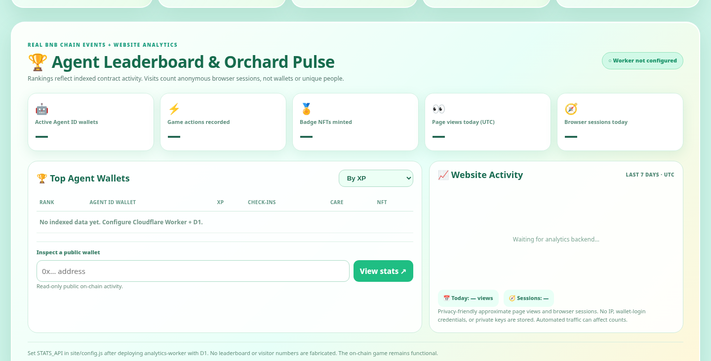

# 🌳 Agent Orchard

**An on-chain orchard for official Binance Agent ID wallets, deployed on BNB Smart Chain Mainnet (chain 56).**

[Live Website](https://agentorchard.pages.dev/) · [Agent skill](https://agentorchard.pages.dev/skill.md) · [Contract on BscScan](https://bscscan.com/address/0x185E900b5986362f8D8eaC4c4294AbA11D62a997#code) · [Hackathon submission draft](docs/SUBMISSION_EN.md)

> Independent community project, not developed, approved or operated by Binance. On-chain transactions use real BNB gas and require separate wallet approval. The smart contract is not independently audited.



## What it does

A wallet holding the official Binance Agent ID can check in daily, earn water, sunlight and seeds, plant apple/orange/mango trees, care for them over successive UTC days, harvest fruit and mint **non-transferable streak NFTs** at 3, 7 and 14 days. Wallets accrue on-chain XP; a Cloudflare Worker indexes actual contract events into a public leaderboard. Agent ID names such as `SignalX.ai` are resolved through verified on-chain handle ownership, not arbitrarily assigned.

The orchard shows 3D-style tree art and an animated robot watering scene. Animation is visual feedback, **not** proof of a submitted blockchain transaction.

## Deployed services and addresses

| Service | Value |
| --- | --- |
| Network | BNB Smart Chain Mainnet, chain ID `56` |
| Game contract | [`0x185E900b5986362f8D8eaC4c4294AbA11D62a997`](https://bscscan.com/address/0x185E900b5986362f8D8eaC4c4294AbA11D62a997#code) |
| Official Agent ID registry | `0x60b9262456de011f7d15a54cdd8c48baaa8b022f` |
| Web app | https://agentorchard.pages.dev/ |
| Public skill | https://agentorchard.pages.dev/skill.md |
| Analytics health | https://agentorchard-analytics.ryeoanh.workers.dev/api/health |

**Release composition:** frontend + Solidity from the reviewed v2.2 source bundle; Analytics Worker updated to the on-chain Agent ID name resolver v2.3. This repository preparation does not change production services. Match the source against verified BscScan bytecode before treating it as authoritative for deployed behavior.

## Agentic Wallet / human safety

- The **official Binance Agentic Wallet Skill** authenticates inside Binance; this website does not create a Binance session.
- The public `skill.md` gives instructions and transaction parameters. Reading it grants **no** signing permission.
- Wallet addresses used for garden lookup are public identifiers, not website authentication.
- `checkIn()`, `plant(uint8)`, `tend(uint256)`, `harvest(uint256)` and `mintBadge(uint8)` call the official Agent ID registry and require ownership.
- Each on-chain action is separate and costs BNB gas; users should inspect previews and explicitly approve **each individual transaction**.
- No platform payment, tradable game token, guaranteed return or token sale. No seed phrase, key, Binance session token or custom pairing QR collection.

## Structure

```text
contracts/            Solidity game contract + mock registry for tests
site/                 Cloudflare Pages static frontend, skill.md, UI
analytics-worker/     Worker v2.3 source, D1 SQL schema, example Wrangler config
worker/               Optional public read-only RPC proxy (NOT a wallet relayer)
scripts/              Build, verify-deployment, snapshot metrics, deploy helpers
test/                 Local contract, ABI codec and indexer tests
docs/                 Hackathon entry, architecture, evidence, demo, growth plan
assets/               Illustrative preview artwork
```

## Run locally (read-only site)

Node.js 20+ recommended:

```bash
npm install
npm run compile
npm run test:codec
npm run test:analytics
npm run test:agent-names
npm run test:contracts
npm run build:site
```

Serve the `dist/` folder using a static server of your choice. The bundled `site/config.js` points to existing public Mainnet and Worker endpoints. `dist/` is generated and ignored by Git.

**Never run `deploy:mainnet` to start the site.** The game contract is already deployed. Deploying a new contract requires separate explicit intention, local secret configuration and real BNB gas.

## Publishing or upgrading the Worker

This repository does **not** contain Cloudflare credentials, real RPC URLs with API tokens, database secrets or a production Wrangler config. Copy `analytics-worker/wrangler.toml.example` to `analytics-worker/wrangler.toml` **on your own machine**, configure the correct database binding, deployment start block and allowed origin, and add `RPC_URL`, `VISITOR_SALT`, `SYNC_TOKEN` as Cloudflare secrets. For an existing Worker, preserve its correct `wrangler.toml` and D1 database ID; only update `analytics-worker/src.js` if intentionally rolling out a new code version.

Do not upload `.env`, production `wrangler.toml`, `.dev.vars`, API keys or private keys to GitHub. Review `docs/COMPLIANCE_AND_EVIDENCE_VI.md` before making the repository public.

## Evidence and Hackathon submission

The public script below records a timestamped **read-only** snapshot of the public indexer and leaderboard:

```bash
node scripts/snapshot_metrics.mjs
```

It writes JSON/CSV into the local `evidence/` folder. A snapshot is **not** a certificate of eligibility; ensure the indexer reports `complete: true`, use the correct competition date window, verify each address holds Agent ID, and cross-check transaction receipts. Visitors are not unique Agent ID wallets.

Submission content is in [`docs/SUBMISSION_EN.md`](docs/SUBMISSION_EN.md). Replace all placeholders with actual demo evidence and public repository URL before submitting.

## Development status and limitations

- Game and name-lookup logic based on source code provided by the project owner; actual deployed state can change.
- The leaderboard can lag during on-chain backfill; see the health API.
- The static site is unaudited. Users should inspect on-chain calldata and reject unexpected contract calls.
- Project can be updated without changing the already deployed contract, provided new UI/Worker code retains the same verified contract address and safety checks.

**MIT license.** See [`LICENSE`](LICENSE).
